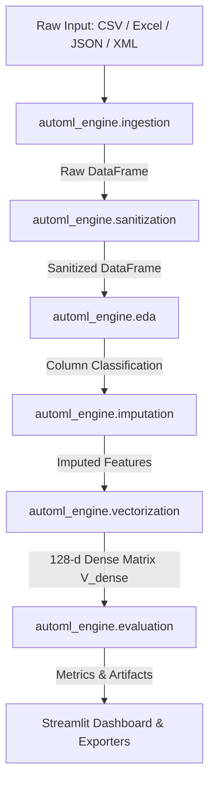

#  SIH 2026 — Automated Preprocessing, EDA & Vectorization Engine

> **Zero-Touch Ingestion (CSV, JSON, XML, Excel) • Regex Auto-Sanitization • Autonomous EDA • Smart NaN Imputation • 128-d Dense Tensor Synthesis • Comparative ML Model Benchmarking**

---

##  Executive Summary

The **SIH 2026 AutoML Engine** is an enterprise-grade, zero-touch machine learning data preprocessing and feature vectorization system built on pure **Object-Oriented Programming (OOP)** principles. It ingests raw, messy, and unstructured data across heterogeneous formats (**CSV, Excel, JSON, XML**), extracts hidden numeric values from unstructured unit strings (`"1,450 sq.ft." -> 1450.0`, `"85 Lakhs" -> 8500000.0`, `"1.5 Crores" -> 15000000.0`), performs autonomous EDA profiling, imputes missing values using KNN & multivariate algorithms, synthesizes a 128-dimensional dense tensor matrix ($V_{\text{dense}}$), and provides a dedicated benchmarking module comparing naive manual EDA against AutoML features across **5 ML model families** (Linear Models, Decision Trees, Random Forests, KNN, XGBoost).

---

## 📁 Repository Structure & Subfolder Documentation

Every major subfolder in this repository contains its own dedicated `README.md` detailing its underlying architecture and classes:

```
SIH_AutoML_Engine/
├── 📄 README.md                            # Main System README (This File)
├── 📄 demo_runner.py                       # Core Engine CLI Runner Script
├── 📁 app/                                 # Streamlit Web Application Dashboard
│   └── 📄 README.md                        # Documentation for Streamlit App Layer
├── 📁 automl_engine/                       # Core OOP AutoML Package
│   ├── 📄 README.md                        # Core Engine Overview
│   ├── 📁 ingestion/                       # Multi-format Ingestors (CSV, Excel, JSON, XML)
│   │   └── 📄 README.md                    # Data Ingestion Layer Documentation
│   ├── 📁 sanitization/                    # Regex Auto-Sanitizer Module
│   │   └── 📄 README.md                    # Token Extraction & Unit Multiplier Guide
│   ├── 📁 eda/                             # Autonomous EDA Profiler Module
│   │   └── 📄 README.md                    # Statistical Profiling Documentation
│   ├── 📁 imputation/                      # NaN Imputation Layer
│   │   └── 📄 README.md                    # KNN & Categorical Imputation Guide
│   ├── 📁 vectorization/                   # Dense Vector Synthesis Module
│   │   └── 📄 README.md                    # 128-d Dense Tensor Matrix (V_dense) Guide
│   ├── 📁 evaluation/                      # Model Evaluator Module
│   │   └── 📄 README.md                    # ML Model Benchmarking Documentation
│   ├── 📁 pipeline/                        # AutoML Pipeline Orchestrator
│   │   └── 📄 README.md                    # End-to-End Orchestrator Documentation
│   └── 📁 utils/                           # Artifact Exporters & Pickle Handlers
│       └── 📄 README.md                    # Exporters Documentation
├── 📁 model_comparator/                    # Dedicated Model Benchmarking Package
│   ├── 📄 README.md                        # Model Comparator Subfolder Documentation
│   ├── 📄 baseline_pipeline.py             # Naive Baseline CSV Generator
│   ├── 📄 engine_pipeline.py               # AutoML Feature CSV Generator
│   ├── 📄 comparator.py                    # Dual Pathway Evaluator (R2, MSE, MAE, RMSE, Acc)
│   ├── 📄 app.py                           # Dedicated Streamlit Visualization App
│   └── 📄 run_comparison_demo.py           # Comparator CLI Demo Script
├── 📁 data/                                # Built-in Sample Datasets (CSV, JSON, XML)
│   └── 📄 README.md                        # Sample Dataset Descriptions
├── 📁 output/                              # Generated Processed CSVs & Exported Matrices
│   └── 📄 README.md                        # Exported Tensor Artifact Descriptions
└── 📁 tests/                               # Automated Test Suite (100% Passed)
    └── 📄 README.md                        # Test Suite Documentation & Execution
```

---

##  Architecture & Pipeline Flowchart



---

##  Quick Start & Execution Commands

### 1. Launch the Main Streamlit Web Application
```bash
streamlit run app/app.py
```

### 2. Launch the Dedicated Model Comparator Dashboard
```bash
streamlit run model_comparator/app.py
```

### 3. Run Core AutoML Engine CLI Demo
```bash
python3 demo_runner.py
```

### 4. Run Dedicated Model Comparator CLI Demo
```bash
python3 model_comparator/run_comparison_demo.py
```

### 5. Run All Automated Unit Test Suites
```bash
python3 tests/test_automl_engine.py
python3 tests/test_model_comparator.py
```

---

##  Key Evaluation Metrics Supported

- **Regression**: Coefficient of Determination ($R^2$), Mean Squared Error (MSE), Root Mean Squared Error (RMSE), Mean Absolute Error (MAE).
- **Classification**: Accuracy, Precision, Recall, F1-Score (Weighted/Macro).

---

##  Model Pickling & Serialization API

```python
from automl_engine.pipeline import AutoMLPipeline

# 1. Fit zero-touch AutoML pipeline
pipeline = AutoMLPipeline(target_dim=128, imputation_strategy="knn")
cleaned_df, v_dense, report = pipeline.fit_transform("data/housing_sample.csv")

# 2. Save fitted pipeline state to .pkl file
model_path = pipeline.save_model("automl_pipeline_model.pkl")

# 3. Load fitted pipeline state from .pkl file
loaded_pipeline = AutoMLPipeline.load_model("automl_pipeline_model.pkl")
```
